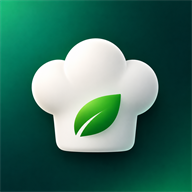
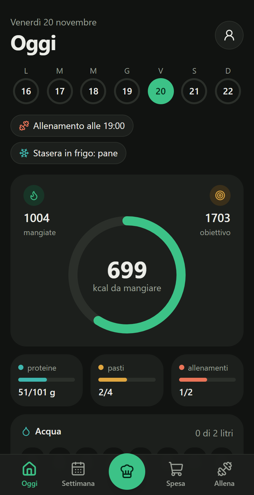
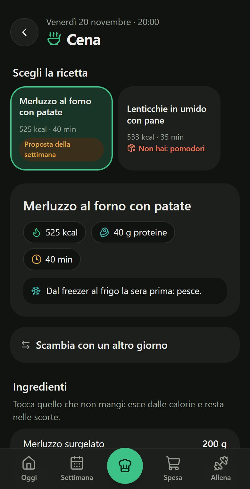
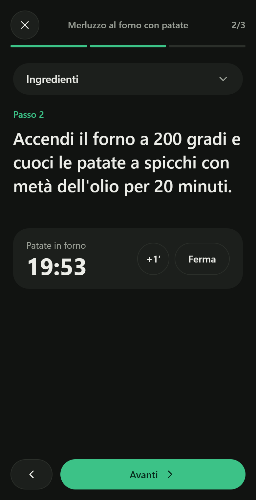
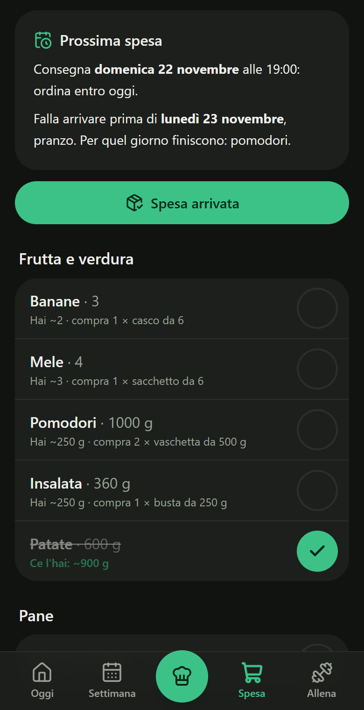
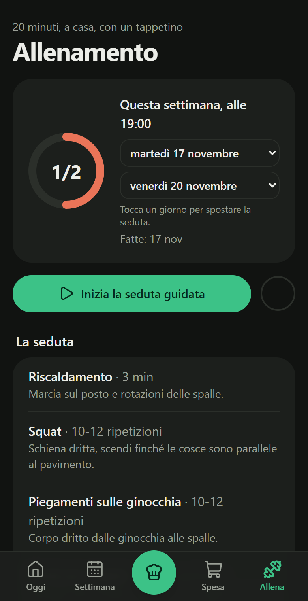
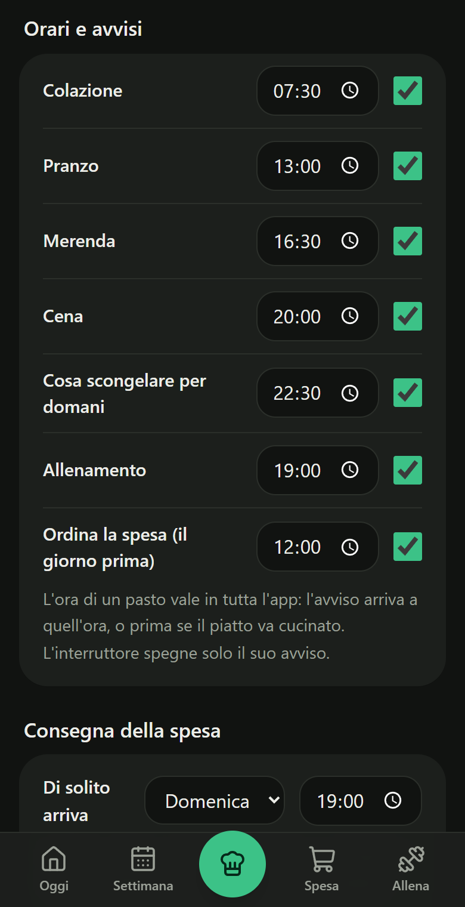
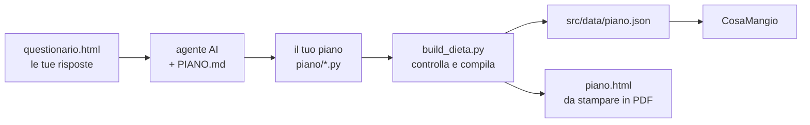

<div align="center">



# CosaMangio

**Apri l'app e sai cosa mangiare.**

Il tuo piano alimentare sul telefono: il pasto del momento, la ricetta passo per passo con i timer,
la spesa della settimana e una notifica quando è ora di mettersi ai fornelli.

[](https://nextjs.org)
[](https://supabase.com)
[](https://vercel.com)
[](#messa-in-funzione)
[](LICENSE)

<br>








<sub>Le schermate usano il piano d'esempio, inventato.</sub>

</div>

> **In English.** CosaMangio ("what do I eat?") is a self-hosted web app to follow a personal meal plan from the
> phone's home screen: the meal of the moment with step-by-step cooking timers, recipes that rotate week by week,
> the weekly shopping list and pantry, and push notifications. Everyone hosts their own copy (Supabase + Vercel)
> with their own plan, written in a single Python file that an AI agent can fill in from a questionnaire. A
> household can share one copy: each user gets their own plan, meal times and reminders at login.
> **The interface and the docs are in Italian.** MIT license. Not medical advice.

## Cosa fa

- 🍽️ **Il pasto giusto, all'ora giusta.** Apri l'app e trovi il pasto del momento con ingredienti, calorie e
  proteine. Segni i pasti fatti e vedi a che punto sei con la giornata, acqua compresa.
- 🔁 **Ricette a rotazione.** Ogni lunedì cambia la proposta, e puoi sempre scegliere un'altra ricetta fra le
  alternative del tuo piano o scambiare il pasto con un altro giorno.
- ⏱️ **Cucina passo per passo.** Un passaggio alla volta, a schermo intero e con lo schermo sempre acceso. Ogni
  "20 minuti" scritto nella ricetta diventa un timer, e ne puoi far girare più di uno.
- 🛒 **Spesa e scorte.** L'app sa cosa hai in casa, ti dice cosa comprare per la settimana e quando fare la
  prossima spesa. Se le dici quando arriva la consegna, ti ricorda di ordinare e ti avvisa se qualcosa finisce
  prima. Se manca qualcosa, propone una ricetta che puoi fare con quello che hai.
- 🔔 **Notifiche.** Quando iniziare a cucinare, cosa spostare dal freezer al frigo la sera prima, quando
  allenarti.
- ⚙️ **Orari tuoi.** L'ora di ogni pasto e di ogni avviso la cambi dall'app, e ogni avviso ha il suo
  interruttore. In vacanza metti il piano in pausa: niente avvisi, e le scorte restano ferme.
- 💪 **Allenamento, se vuoi.** Le sedute della settimana, da spostare con un tocco, e la seduta guidata con i
  timer.
- 📱 **Un'app sulla Home.** Si installa dal browser, anche su iPhone, e si apre come un'app.
- 🔒 **Solo vostra.** Ognuno ospita la sua copia, senza registrazione aperta. In casa la stessa copia può servire
  più persone, ognuna col suo piano e i suoi orari: li sceglie il login.

## Il tuo piano

Tutto il piano sta in un solo file Python: alimenti con calorie e proteine, ricette, la settimana, la spesa e,
se vuoi, l'allenamento. Non serve scriverlo a mano.



1. **Rispondi al questionario.** Apri `piano/questionario.html` con un doppio clic, rispondi e premi "Copia le
   risposte".
2. **Fallo scrivere a un agente AI.** Dai a Claude, ChatGPT, Codex o simili il testo copiato e il file
   [`PIANO.md`](PIANO.md): scriverà `piano/<nome>.py` e ti farà le domande che mancano. Le fasce di calorie e
   proteine non le inventa: te le chiede, e conviene fartele dare da un medico o da un nutrizionista.
3. **Compila.**

   ```powershell
   python scripts/build_dieta.py piano/<nome>.py piano.html src/data/piano.json
   ```

   Il motore controlla che ogni giornata, con qualunque alternativa, resti nelle tue fasce di calorie e
   proteine, e che la spesa basti per qualunque scelta. Se qualcosa non va, esce `Errore nel piano: ...` con
   cosa correggere. `piano.html` si stampa in PDF dal browser.

Vuoi scriverlo a mano? `PIANO.md` descrive ogni campo e `piano/esempio.py` è un piano completo da copiare.
`src/data/piano.json` non si modifica a mano e va committato: il deploy non esegue Python.

### Più persone nella stessa copia

Per una coppia o una famiglia basta una copia. Crea un utente Supabase per persona e scrivi il piano di ognuno
come sopra, generando il JSON in `piano/<nome>.json`. Registralo in `src/data/altri-piani.ts`
(`import nome from "../../piano/<nome>.json"` e `{ nome }`), poi assegnalo all'utente nella tabella `profili`,
dal SQL Editor di Supabase: `insert into public.profili (user_id, piano) values ('<id-utente>', '<nome>')`.
L'id è in Authentication → Users. Chi non ha una riga usa `src/data/piano.json`. Pasti segnati, spesa, notifiche
e orari (pagina Tu) restano di ognuno.

## Messa in funzione

1. **Supabase.** Crea un progetto, esegui `supabase/schema.sql` nel SQL Editor, crea il tuo utente
   (Authentication → Users → Add user, con "Auto confirm") e disattiva le registrazioni di nuovi utenti.
2. **`.env.local`.** Copia `.env.example` e riempi i valori. Le chiavi VAPID per le notifiche le generi con
   `node node_modules/web-push/src/cli.js generate-vapid-keys --json` (dopo `npm install`); `CRON_SECRET` è una
   stringa lunga a caso, e il comando per crearla è nel file.
3. **In locale.** `npm install`, `npm run dev`, poi apri http://localhost:3000.
4. **Vercel.** Importa il repo e copia tutte le variabili di `.env.local` nelle Environment Variables.
5. **Notifiche.** Esegui `supabase/cron.sql` nel SQL Editor, con il dominio di Vercel e `CRON_SECRET`.
6. **Sul telefono.** Su iPhone (iOS 16.4 o successivo) apri il sito in Safari → Condividi → "Aggiungi alla
   schermata Home". Apri l'app dalla Home, fai login, poi Tu → "Attiva le notifiche" → "Prova".

`supabase/migrazioni/` serve solo a chi ha creato lo schema con una versione vecchia: chi parte ora esegue solo
`schema.sql`.

## Come funziona

- **Rotazione.** Per ogni pasto il piano ha un piatto e le sue alternative. La settimana di `INIZIO` propone il
  piatto del piano, poi le alternative girano una settimana dopo l'altra. Una scelta fatta a mano vince sempre.
- **Scorte.** Quando arriva la spesa la segni come arrivata, oppure carichi il documento di consegna (vedi i
  limiti). L'app toglie da lì quello che usano i pasti del piano e ti dice cosa comprare e quando. Oggi conta
  l'orario dei pasti; nei giorni passati in cui ne hai segnato almeno uno, quelli non segnati valgono come saltati.
  Di quello che si conserva compri la quantità fissa della lista, che copre la settimana più pesante della
  rotazione; dei freschi quello che usano i piatti dei 7 giorni dopo la consegna.
- **Profilo.** Per ogni utente la tabella `profili` dice quale piano segue e le sue preferenze: orari, avvisi
  spenti, consegna della spesa, pause. Le preferenze si cambiano dalla pagina Tu e valgono sopra il piano.
- **Guida.** Passo e timer sopravvivono alla chiusura dell'app (`localStorage`), come il contatore dell'acqua.
- **Notifiche.** Ogni 5 minuti Supabase chiama `POST /api/push/tick`. Per ogni pasto la notifica arriva quando
  devi iniziare a cucinare, cioè all'orario del pasto meno i minuti della ricetta; per il primo pasto della
  giornata, all'ora del pasto. La sera (alle 22:30, se non cambi l'ora) arriva il promemoria per il freezer; nei
  giorni di allenamento uno all'ora della seduta; il giorno prima della consegna quello per ordinare la spesa.
  In pausa non parte niente. Per provarle senza inviare nulla, con un'ora simulata nel fuso del piano:

  ```powershell
  curl.exe -X POST -H "Authorization: Bearer <CRON_SECRET>" "http://localhost:3000/api/push/tick?dry=1&at=2026-01-05T12:30"
  ```

## Tenere la tua copia aggiornata

Se tieni la tua copia in un fork, rispetto a questo repo cambiano solo `piano/<nome>.py` e
`src/data/piano.json`. Quando prendi gli aggiornamenti e il merge va in conflitto su `src/data/piano.json`, non
risolverlo a mano: rigeneralo dal tuo piano con il comando sopra.

Dalla 1.0.0 alla 1.0.1: esegui `supabase/migrazioni/profili.sql` nel SQL Editor prima di pubblicare. Se usavi la
variabile `PIANI`, scrivi nella tabella `profili` una riga per ognuno di quegli utenti (il comando è nel file),
poi toglila.

Una ricetta o un prodotto rinominati quando l'app è già in uso perdono i dati salvati (pasti segnati, scorte),
perché i dati su Supabase puntano al loro nome.

## Limiti noti

- I pasti possibili sono cinque, con nomi fissi: colazione, pranzo, merenda, cena, dopocena. Ognuno è
  facoltativo e ha l'orario che vuoi.
- Il documento di consegna si legge solo nel formato di Esselunga (il PDF "Documento di consegna" della spesa
  online), e solo se il piano ha la sezione `SCONTRINO`. Per tutto il resto la spesa arrivata si segna a mano.
- Per cambiare il piano serve Python 3.9 o successivo sul computer.
- I nomi dei timer riconoscono i cibi da un elenco di parole italiane; con ricette diverse usano il nome della
  ricetta.
- L'obiettivo dell'acqua è 2 litri per tutti.
- I piani stanno nel codice che il browser scarica: chi conosce l'indirizzo dell'app li può leggere anche
  senza login. Pasti segnati, spesa e scorte no, restano su Supabase, visibili solo all'utente. Nel piano non
  scrivere quello che vuoi tenere privato.

## Sviluppo

```powershell
npm test          # logica dell'app, sul piano d'esempio (piano/esempio.json)
npx tsc --noEmit
npm run lint
npm run build
```

Dopo una modifica al motore rigenera anche l'esempio:
`python scripts/build_dieta.py piano/esempio.py piano.html piano/esempio.json`.

## Avvertenza

CosaMangio aiuta a seguire un piano; non lo sceglie e non sostituisce un medico o un nutrizionista. Calorie e
proteine sono stime da tabelle ed etichette.

## Licenza

[MIT](LICENSE)
